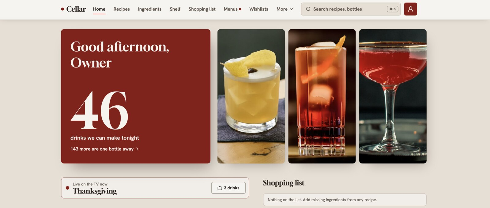
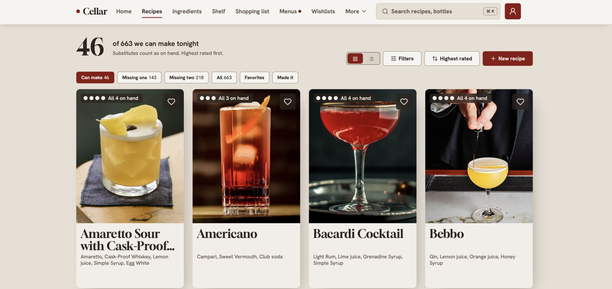
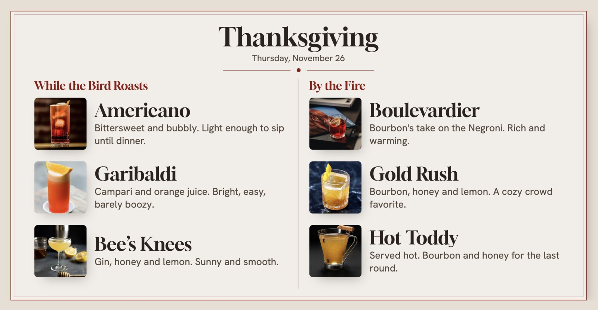

# Cellar

[](https://github.com/ul0gic/cellar/releases/latest)
[](https://github.com/ul0gic/cellar/actions/workflows/ci.yml)
[](LICENSE)

**Your home bar, organized.** Cellar is a self-hosted cocktail app for one household. Tell it what's on your shelf and it tells you what you can make tonight, what one more bottle would unlock, and what to buy next.

One Docker image, one data folder, no account and no cloud. A catalog of 663 cocktails, 296 ingredients and their photos is built in, so it's useful from the first minute.



## What it does

- **What can I make.** Every recipe shows whether you can make it now, counting substitutes, variants and house-made syrups, or exactly what's missing.
- **Shelf and shopping.** Track bottles, open or sealed, and see which purchase unlocks the most drinks. Build a shopping list straight from missing ingredients.
- **Recipes your way.** Add your own, edit the catalog's, scale servings, switch between oz and ml, and print a recipe card.
- **Import anything.** Read a recipe from a web page, paste one as text, or bring in bottles, ingredients and recipes from CSV or JSON.
- **For the whole house.** Each person gets a profile with tasting notes and ratings, kept private or shared, plus favorites and a wishlist. Collections and a party calculator help with planning.
- **A menu on the TV.** Build an event menu and show it on the living-room TV or AirPlay from a private link with a QR code. It updates live as you edit.
- **Backups that restore.** One-click backups of everything, and a tested restore.
- **Optional AI.** Bring your own OpenAI key to draft a recipe from a description, read pages that have no recipe data, or generate a photo. Off until you add a key.





## Install

You need Docker with Compose v2 on linux/amd64 or linux/arm64.

```sh
mkdir -p ~/cellar/data && cd ~/cellar
curl -fsSLO https://github.com/ul0gic/cellar/releases/latest/download/compose.yaml
docker compose up -d
```

Open `http://<server address>:7380`, create the owner, and leave "Load the recipe book" on.

Create `data` yourself, as above: if Docker creates it, root owns it and Cellar can't write to it. Cellar runs as UID 1000; if your `id -u` is different, set the `user:` line in `compose.yaml`.

## Update

```sh
cd ~/cellar
docker compose pull && docker compose up -d
```

Cellar copies its database before any schema change.

## HTTPS

Put Cellar behind your reverse proxy at its own host name, forwarding to port `7380`, and uncomment `CELLAR_TRUSTED_PROXIES=private` in `compose.yaml`. Step-by-step setups for [Nginx Proxy Manager](docs/install.md#nginx-proxy-manager), [Caddy](docs/install.md#caddy), nginx and Traefik are in the install guide.

## More

[docs/install.md](docs/install.md) covers rollback, backup and restore, the TV menu, and every setting, command and exit code.

## Development

Requires Node 26.13.0 and pnpm 10.

```sh
pnpm install
pnpm typecheck        # tsc for every package
pnpm lint             # Biome, then light check
pnpm build:frontend   # the web app
pnpm openapi          # contract/dist/openapi.json
pnpm docker:build     # the image, as cellar:dev
```

Run the server from source on port 7380:

```sh
mkdir -p .rig/dev-data
node catalog/bin/cellar-catalog.ts build --out .rig/dev-catalog
CELLAR_DATA_DIR=.rig/dev-data CELLAR_SHIPPED_CATALOG_DIR=.rig/dev-catalog node backend/bin/cellar.ts serve
```

The packages are `backend/` (the server and the `cellar` command), `frontend/` (the web app), `contract/` (the API, defined once in Zod) and `catalog/` (the recipe catalog and its builder). See [CONTRIBUTING.md](CONTRIBUTING.md) to send a change and [docs/release.md](docs/release.md) for how releases are cut.
